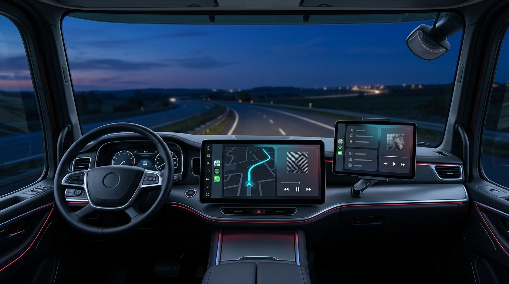
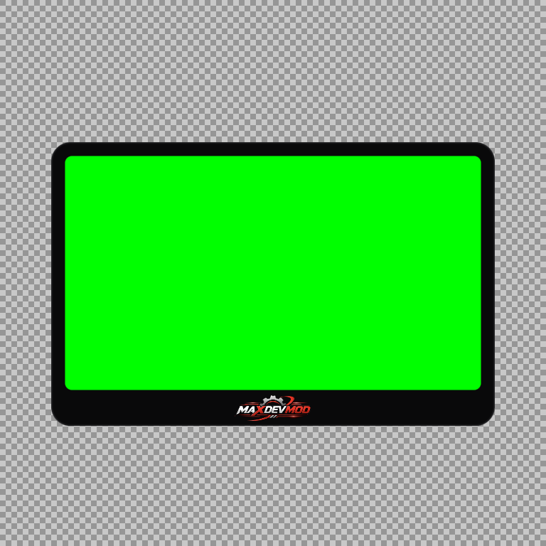
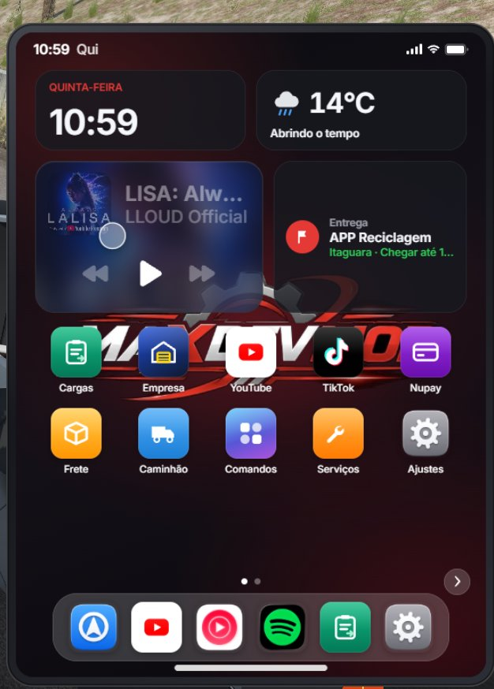
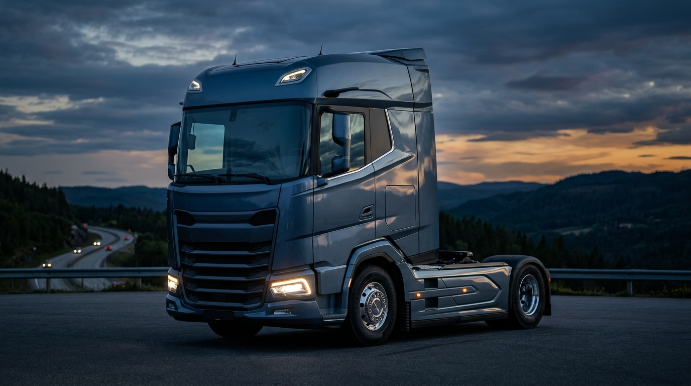
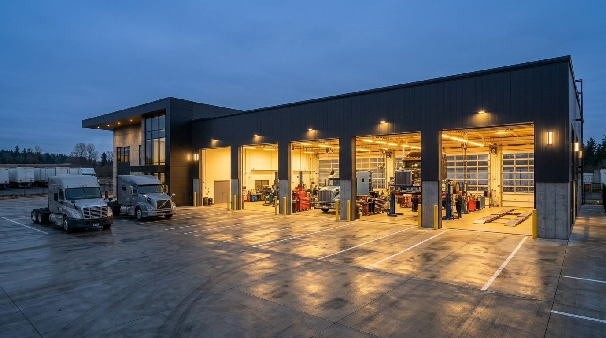
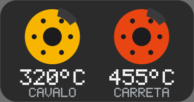

<p align="center"></p>

<h1 align="center">MaxDevMod</h1>

<p align="center">
  <b>Central multimídia estilo CarPlay, celular/iPad interativo, câmera de ré, freios com fumaça 3D e Modo Personagem
  para o Euro Truck Simulator 2 e American Truck Simulator.</b>
</p>

<p align="center">
  <a href="https://github.com/Mateuslima09/MaxDevMod/releases/latest"></a>
  
  
  
  <a href="LICENSE"></a>
</p>

<p align="center">
  <a href="#novidades-da-v251">Novidades</a> ·
  <a href="#central-multimídia-e-tela-flutuante">Central e Tela Flutuante</a> ·
  <a href="#o-celular-e-modo-ipad">Celular e iPad</a> ·
  <a href="#bolsa-de-fretes-garagem-e-nupay-ao-vivo">Empresa ao Vivo</a> ·
  <a href="#freios-fumaça-3d-e-suspensão">Freios e Suspensão</a> ·
  <a href="#câmera-de-ré">Câmera de Ré</a> ·
  <a href="#modo-personagem-beta">Modo Personagem</a> ·
  <a href="#instalação-e-suporte">Instalação</a>
</p>

<br>

<p align="center">
  
</p>

O **MaxDevMod** transforma a cabine do seu caminhão no **Euro Truck Simulator 2 (1.62)** e no **American Truck Simulator
(1.62)** com uma central multimídia completa no painel, um **celular / iPad interativo dentro do jogo** (e no seu
celular real pelo QR Code), gerenciamento ao vivo de fretes, garagens e empréstimos, simulação de aquecimento de freios
com fumaça 3D, câmera de ré com sensores e o **Modo Personagem** para descer do caminhão.

Instalado nos dois jogos, o MaxDevMod detecta e troca automaticamente para o jogo que você abrir.

---

## Novidades da v2.5.2

- **Tutorial interativo de primeiro uso** no celular/iPad (7 etapas guiadas + configuração rápida inicial e botão para rever em *Ajustes*).
- **Modo iPad (iPadOS)** além do modo iPhone, com widgets Liquid Glass, widget de música interativo e YouTube com controle de volume.
- **Bolsa de Fretes, Minha Empresa (com Detalhes + fotos da frota) e Nupay** 100% sincronizados ao vivo com a economia do jogo, sem reiniciar.
- **Detector ao vivo de telas de GPS no DirectX 11**, permitindo exibir o MaxDevMod mesmo em mods de caminhão trancados/criptografados (focando apenas na tela de GPS).
- **Fumaça 3D nas rodas** para freios superaquecidos (cavalo mecânico, carreta, bitrem e rodotrem) + HUD de temperatura.
- **Relatório de Diagnóstico automático (`.txt`)** em *Sobre → Diagnóstico* no app do PC para facilitar suporte e correção de erros.

---

## Central Multimídia e Tela Flutuante

<table>
  <tr>
    <td width="50%" valign="top">
      <picture>
        <source media="(prefers-color-scheme: dark)" srcset="docs/images/maps-dark.png">
        <source media="(prefers-color-scheme: light)" srcset="docs/images/maps-light.png">
        
      </picture>
      <h3>Mapas do seu próprio jogo</h3>
      Desenhado a partir do mapa instalado no seu PC, incluindo DLCs e mods de mapa (ProMods, Minas Gerais, etc.), com
      rota curva a curva e busca de destinos enviada direto para o GPS do jogo. Em mods de mapa protegidos (como Mapa
      Eldorado), a grade acompanha o caminhão junto da rota original.
    </td>
    <td width="50%" valign="top">
      <picture>
        <source media="(prefers-color-scheme: dark)" srcset="docs/images/dashboard-dark.png">
        <source media="(prefers-color-scheme: light)" srcset="docs/images/dashboard-light.png">
        
      </picture>
      <h3>Painel e Mapa Original</h3>
      Mapa ao lado da música, destino e clima da viagem em uma única tela, com alternância rápida para o mapa original
      do caminhão e visual <b>Light Glassmorphism</b> ou modo escuro automático com os faróis.
    </td>
  </tr>
  <tr>
    <td width="50%" valign="top">
      
      <h3>Tela Flutuante e Ajustar Tela</h3>
      Posicione uma tela virtual configurável direto pelo celular ou ajuste bordas, proporção e tamanho do painel em
      cada caminhão de mod (salvo por veículo).
    </td>
    <td width="50%" valign="top">
      
      <h3>Música e YouTube na cabine</h3>
      YouTube, YouTube Music, Spotify e Apple Music com letras, playlists, legendas, qualidade e opção de escolher se o
      áudio sai nos <b>alto-falantes da cabine</b> ou no dispositivo.
    </td>
  </tr>
</table>

**App no PC:** acha o jogo, instala o plugin e o mod de telas, monta seus mapas e permite escolher a nitidez da tela
(**Alta Definição 1536p** ou **Ultra 2048p**).

<p align="center">
  
</p>

---

## O Celular e Modo iPad

Abra e guarde a qualquer momento com **Alt+4** (segure **Alt** para usar com o mouse) ou espelhe no seu celular de
verdade escaneando o QR Code no app do PC. Escolha entre **iPhone** ou **iPad** nos Ajustes!

<table>
  <tr>
    <td width="42%" valign="top" align="center">
      <br>
      <b>Modo iPad (iPadOS)</b><br>
      Relógio, clima, entrega ativa, <b>widget de música interativo</b> (play/pause, avançar/voltar e abrir app) e todos os apps em grade ampla.
    </td>
    <td width="58%" valign="top">
      <h3>Principais apps do celular / iPad</h3>
      <ul>
        <li><b>Tutorial interativo de primeiro uso:</b> ensina teclas, navegação e apps na primeira abertura, com opção de rever em <i>Ajustes → Ver tutorial novamente</i>.</li>
        <li><b>YouTube completo com controle de volume:</b> pesquise vídeos, canais e playlists com barra de volume sempre acessível (<code>−</code> / <code>+</code>, slider e mudo).</li>
        <li><b>Comandos do caminhão:</b> vidros, suspensão a ar, giroflex, pisca-alerta, eixo, luz da cabine, buzinas, freio de mão e carreta.</li>
        <li><b>TikTok e notificações da LIVE:</b> feed oficial + avisos com som no topo da tela quando alguém segue, envia presente ou compartilha sua LIVE.</li>
        <li><b>Frete, Caminhão, Serviços, Personagem, Câmera e Tela Flutuante:</b> tudo acessível sem sair da estrada.</li>
      </ul>
      <br>
      
    </td>
  </tr>
</table>

---

## Bolsa de Fretes, Garagem e Nupay (ao vivo)

Tudo sincronizado diretamente com a memória do jogo — **sem precisar pausar ou reiniciar** (desativado automaticamente
no TruckersMP):

<table>
  <tr>
    <td width="33%" valign="top" align="center">
      <br>
      <b>Bolsa de Fretes</b><br>
      Mercado de Fretes, Mercado de Cargas e Trabalho Rápido ao vivo com busca, filtros, fotos temáticas e tela de transição suave ao aceitar Trabalho Rápido.
    </td>
    <td width="33%" valign="top" align="center">
      <br>
      <b>Minha Empresa & Detalhes</b><br>
      Banners fotográficos para caminhões e carretas, ficha técnica completa (motor, chassi, placa, odômetro, conservação) e troca de caminhão ou engate de carreta na hora.
    </td>
    <td width="33%" valign="top" align="center">
      <br>
      <b>Garagens & Nupay ao vivo</b><br>
      Visualize vagas ocupadas, faça upgrade de garagens (1 → 3 → 5 vagas) com preços reais e acompanhe saldo, extrato e empréstimos instantâneos no Nupay.
    </td>
  </tr>
</table>

---

## Freios, Fumaça 3D e Suspensão

<table>
  <tr>
    <td width="52%" valign="top">
      
    </td>
    <td width="48%" valign="top">
      <ul>
        <li><b>Fadiga e temperatura dos freios (Brake Fade):</b> simulação realista e independente dos discos de freio do cavalo mecânico e das carretas, com avisos sonoros e chiar de freio nas descidas de serra.</li>
        <li><b>Fumaça 3D nas rodas:</b> fumaça dinâmica saindo das rodas do caminhão e de cada carreta (incluindo bitrem e rodotrem) conforme a temperatura sobe (Laranja → Vermelho → Superaquecido), reagindo à velocidade e ao vento.</li>
        <li><b>Suspensão a ar automática:</b> controle manual ou retorno automático calibrado direto pelo app Suspensão no celular.</li>
      </ul>
    </td>
  </tr>
</table>

---

## Câmera de Ré

Engate a ré e o painel muda automaticamente para a **câmera de ré** (na traseira da carreta, se engatada, ou na do
caminhão):

- **Linhas guia dinâmicas** (vermelha 1 m, amarela 2 m, verde 3 m) que curvam com o volante (e invertem com carreta).
- **Sensores de estacionamento** com bipe progressivo e distância em metros ao lado da imagem.
- Renderizada a partir do mapa do jogo (ruas reais, prédios 3D e caminhões de outros jogadores no TruckersMP).

---

## Modo Personagem (beta)

Pare o caminhão, aperte **F8** e desça para andar pelo mundo em 1ª ou 3ª pessoa (single player, completo no ETS2):

- Andar, correr (`Shift`), pular (`Espaço`), agachar (`Ctrl`), porta do motorista animada e **motorista sentado oculto automaticamente na cabine** enquanto você está fora.
- **HUD Liquid Glass** na base da tela mostrando os comandos disponíveis no momento.
- **Nota fiscal e engate manual:** assine a nota com o conferente (`E`) e acople/desacople a quinta roda manualmente.
- **Abastecimento manual com frentista:** abasteça no tanque (`E`) e pague o frentista pelo **balão 3D Liquid Glass** na frente do caminhão.

---

## Veículos e Detecção de Telas

O MaxDevMod funciona **na própria tela do caminhão** ou **no tablet do MaxDevMod** (comprado na oficina):

| American Truck Simulator (1.62) | Euro Truck Simulator 2 (1.62) |
|---|---|
| Freightliner Cascadia (2019 e 2024) | DAF XF e XG/XG+ 2021, XF Electric e XD (e DAF 2021 do Jasper) |
| Kenworth T680 (2022) | Scania S e R (tela 7" ou Smart Dash) e S BEV |
| Volvo VNL (2018 e 2025) e VNR Electric | Iveco S-Way · Renault T (2024) · Volvo FH (2021 e 2024) |
| Western Star 5700XE e 57X | MAN TGX (2020) |
| **Carros:** Ford Bronco (2024) e F-150 (2023) | Ônibus Oyuncuyusbis: Travego 16 SHD, MAN Lion's Coach, Setra S 531 DT e S 516 HD/2 |

- **Mods de caminhão com tela de GPS:** scanner automático de interiores, acessórios de cabine e scripts `ui::map` (até 48 slots de mod) **+ detector ao vivo no DirectX 11** que identifica a tela de GPS mesmo em mods trancados/criptografados!
- **Todos os outros caminhões:** compatíveis via **Tablet do MaxDevMod** na oficina ou pela **Tela Flutuante**.

<details>
<summary><b>O som nos alto-falantes do caminhão (ETS2)</b></summary>
<br>

A música sai dos alto-falantes reais da cabine onde eles existem nos caminhões abaixo (os demais tocam em estéreo):

- **Scania S e R (2016), S BEV:** woofers nas portas, tweeters nas colunas, grave no teto
- **Scania R (2009), Streamline:** woofers nas portas, tweeters nas colunas
- **DAF XF (105), XF Euro 6, XF/XG/XG+ (2021), XF Electric e XD:** portas, colunas, prateleira superior e central
- **MAN TGX, Euro 6 e 2020:** portas, colunas e teto
- **Mercedes-Benz Actros (2009 e 2014):** portas, colunas e prateleira superior
- **Volvo FH (2021, 2024), FH16 (2009 e 2012):** portas e grave na parede traseira
- **Iveco Stralis, Hi-Way e S-Way:** portas, colunas e console superior
- **Renault Magnum, Premium, T e E-Tech T:** portas, colunas, teto e parede traseira
- **Scania PGR do JuseeTV:** acompanha os alto-falantes das peças instaladas

</details>

---

## Instalação e Suporte

1. Baixe o instalador na [última versão (v2.5.2)](https://github.com/Mateuslima09/MaxDevMod/releases/latest) e execute com o ETS2 e o ATS **fechados**.
2. O app abre e guia você automaticamente: encontra o jogo, instala o plugin (`westplay.dll`) e o mod de telas (`westplay.scs`) e monta seu mapa.
3. Para instalar também no outro jogo, vá em **Configuração → Outros jogos → Instalar**.
4. Abra o jogo em **DirectX 11** e entre no caminhão.

> **Aviso do Windows:** o instalador não possui assinatura digital. Se o Windows SmartScreen exibir um aviso, clique em **Mais informações → Executar assim mesmo**.

**Precisa de ajuda com algum erro?** Abra o app do MaxDevMod, vá em **Sobre → Diagnóstico** e clique em **Gerar relatório completo (.txt)**. Ele verifica automaticamente a DLL, o mod, o DirectX 11 e possíveis crashes do jogo, salva um arquivo `.txt` (sem dados pessoais) e abre a pasta pronto para envio.

**Requisitos:** Windows 10 ou 11 (64 bits), **ETS2 1.62** e/ou **ATS 1.62** em DirectX 11 (outras versões podem funcionar) e Microsoft Edge WebView2 (já incluso no Windows 11; instalado automaticamente se faltar).

## Privacidade

O MaxDevMod não possui servidores próprios, contas próprias nem coleta de dados:

- Logins em Apple Music, Spotify, YouTube e TikTok acontecem diretamente nos sites oficiais dentro do seu PC.
- Seu mapa é gerado localmente a partir do seu próprio jogo.
- O celular pelo QR Code comunica-se apenas com o seu PC na rede Wi-Fi local.

<details>
<summary><b>Compilar a partir do código</b></summary>
<br>

Requisitos no Windows: [Rust](https://rustup.rs) (stable) e [Node.js](https://nodejs.org) 24.

```powershell
npm install
cargo build --release -p westplay-plugin
npm run build:release
```

</details>

## Créditos

O MaxDevMod é baseado no [WestPlay](https://github.com/enes-less/WestPlay), de enes-less, criado para o Euro Truck
Simulator 2. Para apoiar o autor do WestPlay original, veja o [Kreosus dele](https://kreosus.com/enes-less).

Gostou do MaxDevMod? Deixe uma estrela no repositório:

<p>
  <a href="https://github.com/Mateuslima09/MaxDevMod"></a>
</p>

## Licença

Distribuído sob a licença **GNU General Public License v3.0 ou posterior (GPL-3.0-or-later)**. Veja [LICENSE](LICENSE),
[THIRD_PARTY_LICENSES.md](THIRD_PARTY_LICENSES.md) e [THIRD_PARTY_NOTICES.md](THIRD_PARTY_NOTICES.md).

<sub>O MaxDevMod é um projeto independente, sem ligação ou endosso da Apple, SCS Software, Spotify, Google, TikTok, Nubank ou montadoras. Marcas citadas pertencem aos seus respectivos proprietários.</sub>
