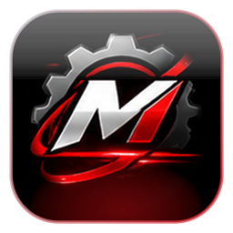
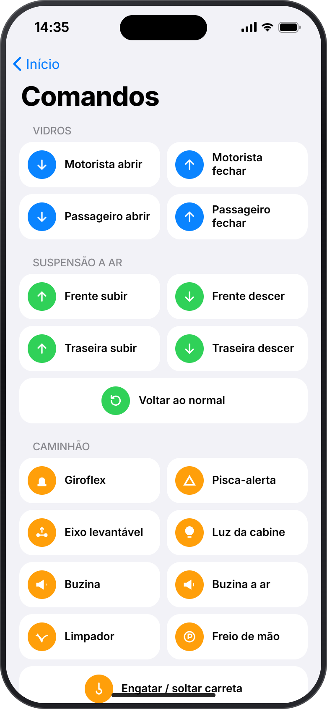

<p align="center"></p>

<h1 align="center">WestPlay</h1>

<p align="center">
  <b>Uma tela no estilo CarPlay para os caminhões do American Truck Simulator e do Euro Truck Simulator 2.</b><br>
  Seu mapa, sua música e o YouTube na tela do painel do caminhão, e um celular dentro do jogo.
</p>

<p align="center">
  <a href="https://github.com/Mateuslima09/ATS-CarPlay/releases/latest"></a>
  
  
  
  <a href="LICENSE"></a>
</p>

<p align="center">
  <a href="#recursos">Recursos</a> ·
  <a href="#o-celular">O celular</a> ·
  <a href="#veículos">Veículos</a> ·
  <a href="#instalação">Instalação</a> ·
  <a href="#privacidade">Privacidade</a>
</p>

<br>

<picture>
  <source media="(prefers-color-scheme: dark)" srcset="docs/images/home-dark.png">
  <source media="(prefers-color-scheme: light)" srcset="docs/images/home-light.png">
  
</picture>

O WestPlay coloca uma central multimídia no estilo de um carro moderno na tela do painel do seu caminhão, dentro do
jogo. Ela traz a rota num mapa feito a partir do seu próprio jogo, sua música, o YouTube e o clima da viagem, tudo no
lugar onde um caminhão de verdade tem a tela. Você usa com o mouse segurando uma tecla (Alt esquerdo, por padrão).

Funciona no **American Truck Simulator** e no **Euro Truck Simulator 2**. Instalado nos dois, o WestPlay troca sozinho
para o jogo que você abrir.

## Recursos

<table>
  <tr>
    <td width="50%" valign="top">
      <picture>
        <source media="(prefers-color-scheme: dark)" srcset="docs/images/maps-dark.png">
        <source media="(prefers-color-scheme: light)" srcset="docs/images/maps-light.png">
        
      </picture>
      <h3>Mapas do seu próprio jogo</h3>
      Desenhado a partir do mapa do seu jogo, com DLCs e mods de mapa (ProMods e outros), com a rota, as
      instruções curva a curva e a busca de destinos, que manda a rota para o GPS do jogo.
    </td>
    <td width="50%" valign="top">
      <picture>
        <source media="(prefers-color-scheme: dark)" srcset="docs/images/dashboard-dark.png">
        <source media="(prefers-color-scheme: light)" srcset="docs/images/dashboard-light.png">
        
      </picture>
      <h3>Um painel para a viagem</h3>
      O mapa ao lado do que está tocando, do destino e do clima no caminho, tudo numa tela só.
    </td>
  </tr>
  <tr>
    <td width="50%" valign="top">
      
      <h3>Sua música</h3>
      Apple Music, Spotify e YouTube Music, com Tocando Agora e letras. O clipe da música passa no próprio Tocando
      Agora, e o YouTube tem canais, playlists, legendas e qualidade. O som sai dos alto-falantes do caminhão.
    </td>
    <td width="50%" valign="top">
      <picture>
        <source media="(prefers-color-scheme: dark)" srcset="docs/images/looks-light.png">
        <source media="(prefers-color-scheme: light)" srcset="docs/images/looks-dark.png">
        
      </picture>
      <h3>Claro, escuro e do seu jeito</h3>
      Escurece à noite ou quando você liga os faróis, como o sensor de luz de um carro. Use seus próprios papéis de
      parede e ícones.
    </td>
  </tr>
  <tr>
    <td width="50%" valign="top">
      
      <h3>Ajustar Tela</h3>
      Bordas, proporção e tamanho do WestPlay em cada tela, salvos por veículo, para caminhões de mod com telas de
      formatos diferentes. Dá para ajustar também pelo celular, se a tela ficar pequena demais para alcançar os
      Ajustes.
    </td>
    <td width="50%" valign="top">
      
      <h3>Mesmo sem mapa, ele segue você</h3>
      Num perfil cujo mapa o WestPlay não consegue montar (um mod de mapa protegido, como o Mapa Eldorado), o Mapas
      continua acompanhando o caminhão: uma grade que anda com você, o caminho já feito e a rota do GPS do jogo.
    </td>
  </tr>
</table>

**O app no seu PC** cuida de tudo: acha o jogo, instala o WestPlay nele, monta o seu mapa e mostra em que jogo o
WestPlay está conectado.

<p align="center">
  
</p>

## O celular

Um celular no estilo iPhone **dentro do jogo**, que aparece e some com **Alt+4**, e o mesmo celular **no seu celular de
verdade**, pelo QR Code que o app mostra no PC. Os dois funcionam ao mesmo tempo, em qualquer caminhão, com ou sem a
tela do WestPlay no painel.

<table>
  <tr>
    <td width="25%" valign="top" align="center">
      <br>
      <b>Início</b><br>Hora do jogo, velocidade e combustível, o que está tocando e os apps.
    </td>
    <td width="25%" valign="top" align="center">
      <br>
      <b>Nupay</b><br>O saldo da sua conta no jogo, o que entrou e o que saiu: fretes, multas, pedágios e balsas. Em
      dólar, real ou euro.
    </td>
    <td width="25%" valign="top" align="center">
      <br>
      <b>Comandos</b><br>Vidros, suspensão a ar, giroflex, pisca-alerta, eixo, luz da cabine, buzinas, freio de mão e
      carreta.
    </td>
    <td width="25%" valign="top" align="center">
      <br>
      <b>Ajustes</b><br>Claro ou escuro, milhas ou km, a moeda do Nupay, o papel de parede, o volume e o Ajustar Tela.
    </td>
  </tr>
</table>

Ele também tem **Frete** (a carga e o peso, de onde para onde, quanto falta e quanto paga), **Caminhão** (velocidade, combustível, autonomia,
piloto automático, motor, freio de mão e luzes), **Serviços** (abre a janela de serviços do jogo, com guincho e
oficina, e estaciona rápido), o **mapa** e a **música**: YouTube Music, Spotify e o que estiver tocando.

**O painel no celular.** O outro QR Code abre a tela do caminhão inteira no seu celular, deitado: o mapa, a rota, o
que está tocando. É a mesma tela do painel, e tudo o que você faz nela vale no jogo.

<p align="center">
  
</p>

Para usar pelo celular de verdade, ele precisa estar na mesma rede Wi-Fi do PC. Abra o WestPlay no PC, vá em **Tela
do caminhão** e escaneie um dos QR Codes com a câmera.

## Veículos

O WestPlay aparece de dois jeitos: **na própria tela do caminhão** ou **no tablet do WestPlay**.

**Na própria tela do caminhão.** Nos caminhões que têm tela no painel, o WestPlay ocupa o lugar do GPS, no formato
dela. Não precisa comprar nem instalar nada: é entrar e ele está lá.

| American Truck Simulator | Euro Truck Simulator 2 |
|---|---|
| Freightliner Cascadia (2019 e 2024) | DAF XF e XG/XG+ 2021, XF Electric e XD (e o DAF 2021 do Jasper) |
| Kenworth T680 (2022) | Scania S e R, com a tela de 7" ou o Smart Dash, e o S BEV |
| Volvo VNL (2018 e 2025) e VNR Electric | Iveco S-Way |
| Western Star 5700XE e 57X | Renault T (2024) |
| **Carros:** Ford Bronco (2024) e F-150 (2023) | Volvo FH (2021 e 2024) |
| | Ônibus do Oyuncuyusbis: Travego 16 SHD, MAN Lion's Coach, Setra S 531 DT e S 516 HD/2 |

**Caminhões de mod com tela própria.** O WestPlay procura nos mods instalados os caminhões que têm tela de GPS e passa
a usar essa tela sozinho, sem precisar de nada a mais. Se ela ficar torta ou cortada, use o **Ajustar Tela**.

**No tablet do WestPlay.** Os outros caminhões, do jogo ou de mod, ganham o WestPlay num tablet que você coloca na
oficina: em Acessórios, nos Itens pendurados ou como conjunto de painel. A tela do caminhão continua com a navegação do
jogo.

|  | Tela do caminhão | Tablet do WestPlay |
|---|---|---|
| Caminhões | Os da lista e os de mod com tela | Todos os outros |
| Como ter | Nada: já está lá | Coloque na oficina |
| A navegação do jogo | Trocada pelo WestPlay | Continua na tela do caminhão |

<details>
<summary><b>O som nos alto-falantes do caminhão (ETS2)</b></summary>
<br>

A música sai dos alto-falantes do caminhão, cada um onde fica na cabine. Os outros caminhões tocam em estéreo simples.

- **Scania S e R (2016), S BEV:** woofers nas portas, tweeters nas colunas, grave no teto
- **Scania R (2009), Streamline:** woofers nas portas, tweeters nas colunas
- **DAF XF (105):** tweeters nas colunas; dois pares na prateleira de cima na Super Space Cab, um na de cima nas outras
- **DAF XF Euro 6:** woofers nas portas, tweeters nas colunas; dois pares na prateleira de cima na Super Space Cab, um nas outras
- **DAF XF, XG, XG+ (2021), XF Electric e XD:** woofers nas portas, tweeters nas colunas, um par em cima, um central
- **MAN TGX:** woofers nas portas; na XXL, também duas caixinhas no alto de cada parede lateral
- **MAN TGX Euro 6:** woofers nas portas; na XL, também uma caixinha em cada canto do teto
- **MAN TGX (2020):** um woofer e um médio em cada porta, tweeters nas colunas
- **Mercedes-Benz Actros (2014):** woofers nas portas, um par em cima, tweeters nas colunas
- **Mercedes-Benz Actros (2009):** woofers nas portas, um par nos cantos da prateleira de cima
- **Volvo FH (2021, 2024), FH16 (2012):** woofers nas portas, grave na parede de trás
- **Volvo FH16 (2009):** uma caixa em cada porta
- **Iveco Stralis:** uma caixa em cada ponta do console de cima e, nos tetos altos, uma pequena do lado do passageiro
- **Iveco Hi-Way:** uma caixa em cada ponta do console de cima e uma no alto de cada lado
- **Iveco S-Way:** um woofer e um tweeter em cada porta
- **Renault Magnum:** uma caixa em cada canto do teto, tweeters no console de cima
- **Renault Premium:** uma caixa de cada lado do teto, mais baixa no teto baixo
- **Renault T:** tweeters nas colunas, um par na parede de trás; woofers nas portas nos interiores 2024
- **Renault E-Tech T:** woofers nas portas, tweeters nas colunas, um par na parede de trás
- **Scania PGR do JuseeTV:** os alto-falantes das peças que você colocar: portas, colunas, console de cima, parede de trás

</details>

## Instalação

1. Baixe o instalador na [última versão](https://github.com/Mateuslima09/ATS-CarPlay/releases/latest) e rode, com os
   jogos fechados.
2. O app abre e guia você no resto: acha o jogo, instala o plugin e o mod de telas do WestPlay e monta o seu mapa.
3. Para usar também no outro jogo, vá em **Configuração → Outros jogos** e clique em **Instalar**.
4. Abra o jogo e entre num caminhão.

O instalador não é assinado. Se o Windows bloquear, clique em **Mais informações → Executar assim mesmo**. Esta versão
não procura atualizações sozinha: as novas ficam na página de [versões](https://github.com/Mateuslima09/ATS-CarPlay/releases).

**Requisitos:** Windows 10 ou 11 (64 bits), American Truck Simulator e/ou Euro Truck Simulator 2 na versão 1.61 (outras
podem funcionar; o app avisa quando uma não foi testada) e o Microsoft Edge WebView2 (já vem no Windows 11; o
instalador coloca onde faltar).

## Privacidade

O WestPlay não tem servidores, contas próprias nem coleta de dados. Ele não junta nem envia nada sobre você.

- Você entra no Apple Music, no Spotify e no YouTube nas páginas deles, no navegador do próprio WestPlay no seu PC,
  como faria num navegador. O WestPlay não guarda dados das suas contas.
- O seu mapa é montado a partir do seu jogo, no seu PC, e fica lá.
- O celular pelo QR Code fala só com o seu PC, pela sua rede Wi-Fi.
- O WestPlay só fala com os serviços que você usa.

<details>
<summary><b>Compilar a partir do código</b></summary>
<br>

Você precisa do [Rust](https://rustup.rs) (stable) e do [Node.js](https://nodejs.org) 24, no Windows.

```sh
npm install      # as ferramentas do app e os pacotes da interface
npm run dev      # o WestPlay, com a interface servida ao vivo
```

`cargo test --workspace` e `npm test --prefix ui` rodam os testes. O plugin do jogo é compilado com
`cargo build --release -p westplay-plugin`.

</details>

## Créditos

Esta versão é baseada no [WestPlay](https://github.com/enes-less/WestPlay), de enes-less, feito para o Euro Truck
Simulator 2. Ela traz o American Truck Simulator, os dois jogos juntos, o celular dentro do jogo e pelo QR Code, o
Nupay e o resto descrito acima. Para apoiar o autor do WestPlay original:

<p>
  <a href="https://kreosus.com/enes-less"></a>
</p>

## Licença

O WestPlay é software livre: você pode redistribuir e modificar nos termos da GNU General Public License, versão 3 ou
(se preferir) qualquer versão posterior. Veja [LICENSE](LICENSE).

As bibliotecas que vêm com o WestPlay mantêm as próprias licenças: veja
[THIRD_PARTY_LICENSES.md](THIRD_PARTY_LICENSES.md) e [THIRD_PARTY_NOTICES.md](THIRD_PARTY_NOTICES.md).

<sub>O WestPlay é um projeto independente, sem ligação com a Apple, a SCS Software, o Spotify, o Google, o Nubank ou as
montadoras, nem endossado por eles. CarPlay, Apple Music, Spotify, YouTube, YouTube Music e os nomes e marcas das
montadoras pertencem aos seus donos e são usados só para dizer com o que o WestPlay funciona. Os prints mostram a
prévia do WestPlay com dados de exemplo.</sub>
